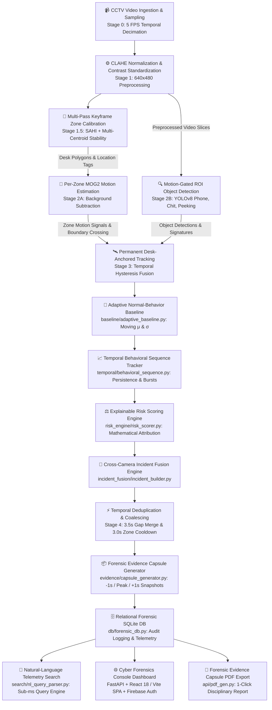

# 🛡️ TRINETRA AI (त्रिनेत्र) — Offline Examination Video Forensics Platform

<div align="center">

[](https://www.python.org/)
[](https://fastapi.tiangolo.com/)
[](https://github.com/ultralytics/ultralytics)
[](https://opencv.org/)
[](https://reactjs.org/)
[](https://vitejs.dev/)
[](https://firebase.google.com/)
[](https://sqlite.org/)
[](LICENSE)

**"See What Others Miss."**  
*Transforming hours of examination surveillance footage into ranked, explainable, cross-camera evidence.*

[Key Features](#-key-unique-selling-points-usps) • [Pipeline Architecture](#-pipeline-architecture) • [System Visualizations](#-system-visualizations) • [Quick Start](#-quick-start--installation) • [REST API](#-rest-api-endpoints) • [Forensic Philosophy](#-forensic-role--philosophy)

</div>

---

## 🎯 Executive Summary & Vision

Manual review of multi-hour examination hall surveillance footage is tedious, subjective, and prone to severe investigator fatigue. **Trinetra AI** (त्रिनेत्र — *The All-Seeing Third Eye*) transforms manual examination CCTV monitoring into an automated, transparent, and explainable **Forensic Investigation Platform**.

By executing a decoupled, 100% offline-first AI pipeline, Trinetra AI filters environmental noise, models normal room baseline behavior dynamically, fuses multi-camera cross-viewpoint anomalies into prioritized incidents, and produces self-contained **Evidence Capsules** for academic integrity and disciplinary committees.

### ⚖️ Forensic Role & Philosophy
- **Investigation-Support Tool:** Trinetra AI is strictly an evidentiary and investigative aid. It **never asserts guilt** or labels students as "cheaters".
- **Approved Forensic Terminology:** Findings are classified strictly as **"Potentially Relevant Events"**, **"Behavioral Deviations"**, and **"Anomalous Activity"** associated with mathematical **Risk Indices (0–100)**.
- **Privacy by Design:** Employs anonymous spatial identifiers (e.g., `Desk_S01`, `Track_001`, `Row 2 Middle Desk`) and physical seating coordinate maps. **Zero facial recognition or biometric tracking** is performed.

---

## 🏛️ Pipeline Architecture

Trinetra AI operates as a decoupled **7-stage offline pipeline**, isolating ingestion, calibration, motion analysis, object detection, behavioral tracking, coalescing, and evidence synthesis.



---

## 🌟 Key Unique Selling Points (USPs)

### 1. 🎯 Fast Keyframe Multi-Pass Zone Calibration (`Stage 1.5`)
- Automatically identifies and locks all student desk polygons without tedious manual coordinate tagging.
- Uses a multi-pass hierarchical approach:
  1. **SAHI (Slicing Aided Hyper Inference)** small-tile (192px) sliced detection.
  2. **2x2 grid quadrant 2x upscaling** pass for distant classroom rows.
  3. **Multi-frame centroid stability aggregation** across keyframes.
- Locks the complete `zone_map.json` in **~15 seconds** (85% speedup over brute-force scanning) and auto-maps pixels to physical descriptions (e.g., *"Row 1 (Back) -- Center-Left Desk"*).

### 2. 🧠 Adaptive Normal-Behavior Baseline (`baseline/`)
- Dynamically learns baseline examination room behavior (writing, page-turning, posture shifts, brief glances) during an initial calibration window.
- Computes running moving mean ($\mu$) and standard deviation ($\sigma$) per desk.
- Flags sustained behavioral deviations via adaptive $Z$-scores rather than static, brittle thresholds.

### 3. 📈 Temporal Behavioral Sequence Analysis (`temporal/`)
- Evaluates multi-frame temporal sequences rather than isolated static frames.
- Models motion frequency, intensity bursts, duration persistence, repetition cycles, and inter-desk boundary reach.

### 4. ⚖️ Explainable Mathematical Risk Scoring Engine (`risk_engine/`)
- Generates transparent, deterministic risk scores (0–100) with complete factor attribution:
  | Risk Factor | Weight Range | Forensic Evaluation Criteria |
  | :--- | :---: | :--- |
  | **Motion Intensity** | `+0 to +25` | Peak movement density exceeding baseline threshold |
  | **Motion Repetition** | `+0 to +25` | Cyclic periodic movements indicative of signaling/peeking |
  | **Duration Persistence** | `+0 to +15` | Continuous anomalous behavior duration |
  | **Boundary Crossing** | `+0 to +15` | Physical hand or head reach into adjacent desk zones |
  | **Prohibited Object Interaction** | `+0 to +20` | YOLOv8 detection of phones, paper chits, or unauthorized items |
  | **Cross-Camera Corroboration** | `+0 to +10` | Simultaneous confirmation from multiple camera angles |
- Categorized Risk Tiers: `LOW (0-30)`, `MEDIUM (31-60)`, `HIGH (61-80)`, `CRITICAL (81-100)`.

### 5. 🔗 Cross-Camera Incident Fusion (`incident_fusion/`)
- Synchronizes multi-camera feeds using timestamp proximity, camera IDs, and spatial zone topologies.
- Merges concurrent multi-view triggers into unified incident dossiers, eliminating duplicate alerts across overlapping viewpoints.

### 6. 📦 Self-Contained Forensic Evidence Capsules (`evidence/`)
- For every prioritized incident, Trinetra synthesizes a tamper-evident **Evidence Capsule**:
  - **Temporal Frame Snapshots:** Pre-Event (-1.0s), Peak Anomaly Event, and Post-Event (+1.0s).
  - **Localized Crop & Heatmap:** High-resolution desk ROI crop with overlaid motion intensity.
  - **Annotated Video Clip:** Standalone H.264 `.mp4` clip with student bounding boxes, tracking HUD, and risk badges.
  - **Factor Breakdown & Explanation:** Mathematical attribution explaining why the event was flagged.

### 7. 🔎 Natural-Language Telemetry Search (`search/`)
- Sub-millisecond keyword and expression query parser enabling natural search:
  - `"Show all high-risk events"`
  - `"Show events involving mobile phone"`
  - `"Show peeking events at Desk 5"`
  - `"Camera 2 risk above 75"`
  - `"Cross-camera corroborated incidents"`

### 8. 📱 Motion-Gated YOLOv8 Object Detection (`Stage 2B`)
- Custom-trained YOLOv8 weights (`best.pt`) optimized for examination objects: `person`, `phone`, `chit`, `hand`, `peeking`, `supplement-passing`.
- Gated by MOG2 motion density: inference runs only when physical movement occurs in a desk zone, drastically minimizing CPU/GPU load.

### 9. 🔥 Dual Heatmaps (Global Optical vs. Student Suspicion)
- **Global Hall Heatmap:** Optical motion density accumulation across the entire classroom.
- **Student Activity Heatmap:** Baseline-normalized suspicion score per calibrated desk polygon.

### 10. 🗄️ Relational Forensic SQLite DB & Audit Logging (`db/`)
- Maintains tamper-evident chain of custody tracking investigator actions, incident reviews, and system status across `incidents`, `events`, `evidence_capsules`, and `audit_logs` tables.

### 11. 📑 1-Click Publication-Ready PDF Reports (`api/pdf_gen.py`)
- Generates official, publication-ready PDF Forensic Evidence Reports and individual Evidence Capsule PDFs ready for disciplinary panels.

### 12. 🌐 Modern Cyber Forensics Console (React 18 + Vite SPA)
- Dark glassmorphic cyber UI with responsive layout, real-time telemetry, Firebase Authentication (Google OAuth + Email/Password), 24-hour session persistence, interactive 3D spatial seating matrix, and timeline playback.

---

## 📸 System Visualizations

### 1. Classroom Zone Calibration Preview

> **Figure 1:** Calibrated seating polygons automatically detected in Stage 1.5. Solid borders denote verified desk zones with multi-frame centroid stability.

---

### 2. Student Activity & Suspicion Heatmap

> **Figure 2:** Time-aggregated student suspicion heatmap color-coded from nominal/low (blue/cyan) to high risk (orange/red).

---

### 3. Annotated Multi-Object Forensics Frame

> **Figure 3:** Real-time HUD overlay rendering desk polygons, tracking IDs, motion vectors, and detected anomalies.

---

## 📁 Repository Directory Structure

```text
Trinetra-/
├── api/
│   ├── __init__.py
│   ├── pdf_gen.py                     # Official PDF Evidence Capsule & Dossier Generator (FPDF2)
│   └── server.py                      # FastAPI REST server & telemetry backend
├── assets/                            # System visualization assets & reference diagrams
│   ├── annotated_frame.png
│   ├── calibration_preview.jpg
│   └── heatmap_student.png
├── baseline/
│   └── adaptive_baseline.py           # Dynamic room baseline & moving Z-score calculator
├── config/
│   └── config.yaml                    # Master pipeline configuration parameters
├── db/
│   └── forensic_db.py                 # SQLite relational database & audit logger
├── evidence/
│   └── capsule_generator.py           # Snapshot extractor (-1s, peak, +1s) & clip bundler
├── incident_fusion/
│   └── incident_builder.py            # Multi-camera temporal correlation & cluster engine
├── risk_engine/
│   └── risk_scorer.py                 # Transparent 0-100 mathematical risk scoring engine
├── search/
│   └── nl_query_parser.py             # Natural-language forensic query engine
├── stages/
│   ├── stage_0_ingestion.py           # Video reader & dynamic FPS resampling (5 FPS)
│   ├── stage_1_preprocess.py          # CLAHE contrast normalization & standardization (640x480)
│   ├── stage_1_5_zone_calibration.py  # Fast multi-pass keyframe desk calibration (SAHI)
│   ├── stage_2a_motion.py             # MOG2 per-zone motion & boundary tracking
│   ├── stage_2b_object.py             # Motion-gated YOLOv8 ROI object detection
│   ├── stage_3_tracking_fusion.py     # Desk-anchored tracking & temporal hysteresis
│   ├── stage_4_event_segmentation.py  # Event coalescing, cooldown, & H.264 clip rendering
│   └── stage_5_output.py              # Output synthesis, database population, & heatmaps
├── temporal/
│   └── behavioral_sequence.py         # Multi-frame behavioral sequence & persistence model
├── src/                               # React 18 / Vite Frontend Source Code
│   ├── App.jsx                        # Main SPA controller & router
│   ├── firebase.js                    # Firebase Auth & Firestore telemetry integration
│   ├── components/                    # UI Components (Sidebar, Topbar, Modals, Dossiers)
│   ├── pages/                         # Forensic Views (Artifacts, Forensics, Spatial, Audit)
│   └── styles/                        # Dark cybersecurity design system
├── web/                               # Production compiled web assets (served by FastAPI)
├── index.html                         # Vite root HTML template
├── main.py                            # Central pipeline orchestration CLI
├── package.json                       # Frontend dependencies & scripts
├── requirements.txt                   # Python dependencies
├── vite.config.js                     # Vite build & proxy configuration
├── info.txt                           # Comprehensive project specification document
└── README.md                          # Master project documentation
```

---

## 🚀 Quick Start & Installation

### 1. Prerequisites
- **Python:** 3.10 or higher
- **FFmpeg:** Installed and added to system `PATH` (required for video transcoding and capsule rendering)
- **Node.js:** 18+ (optional, only required if rebuilding the frontend bundle)

### 2. Clone the Repository
```bash
git clone https://github.com/aryanreddy13/Trinetra-.git
cd Trinetra-
```

### 3. Set Up Python Virtual Environment
**On Windows:**
```powershell
python -m venv .venv
.venv\Scripts\activate
```

**On Linux / macOS:**
```bash
python3 -m venv .venv
source .venv/bin/activate
```

### 4. Install Dependencies
```bash
pip install -r requirements.txt
```

---

## 💻 Usage & Execution

### A. Run CLI Video Forensics Pipeline
Process raw examination CCTV footage through all 7 stages:
```bash
# Clean previous outputs and execute pipeline on target video
python main.py --clean --input path/to/cctv_video.mp4
```

CLI flags available:
- `--input <path>`: Path to input CCTV video file (`.mp4`, `.avi`, `.mov`).
- `--clean`: Wipes previous run outputs in `outputs/` before execution.
- `--config <path>`: Custom configuration file (defaults to `config/config.yaml`).

### B. Launch the Web Forensics Console
Start the FastAPI server (serves the interactive console at port 8000):
```bash
python -m uvicorn api.server:app --host 0.0.0.0 --port 8000
```
Open **`http://localhost:8000`** in your browser.

> **Demo Access Credentials:**
> - Email: `proctor@trinetra.ai`
> - Password: `Proctor123!`
> *(Or use 1-click Google OAuth Sign-In)*

### C. (Optional) Run Frontend in Development Mode
If customizing the React frontend:
```bash
npm install
npm run dev
```
Access Vite dev server at `http://localhost:3000` (auto-proxies `/api` to FastAPI on port 8000).

---

## 📡 REST API Endpoints

The FastAPI backend exposes comprehensive REST endpoints for telemetry, search, and evidence retrieval:

| Method | Endpoint | Description |
| :--- | :--- | :--- |
| `GET` | `/api/overview` | Pipeline execution summary, KPI counts, and zone stats |
| `GET` | `/api/incidents` | Ranked list of prioritized forensic incidents |
| `GET` | `/api/search?q={query}` | Natural language and keyword query search |
| `GET` | `/api/capsules/{incident_id}` | Detailed Evidence Capsule metadata, factor attribution, and snapshots |
| `GET` | `/api/report/capsule/{incident_id}` | Generates and downloads official Evidence Capsule PDF |
| `GET` | `/api/report/summary` | Downloads full examination integrity summary PDF report |
| `GET` | `/api/media/clip/{clip_id}` | Streams annotated H.264 MP4 video evidence clip |
| `GET` | `/api/zones` | Calibrated desk polygons and physical seating map coordinates |
| `POST` | `/api/upload` | Uploads new CCTV video and initiates processing pipeline |

---

## ⚡ Evidence Reduction Funnel

Trinetra AI systematically eliminates false positives and noise:

$$\text{Raw Motion Bursts (69)} \xrightarrow{\text{CLAHE \& MOG2}} \text{Noise-Filtered Events (11)} \xrightarrow{\text{Adaptive Baseline}} \text{Deviations (10)} \xrightarrow{\text{Spatial Fusion}} \text{Fused Incidents (1)} \xrightarrow{} \text{Prioritized Capsule}$$

- **88% Fatigue Reduction:** Investigators review only prioritized, high-confidence evidence capsules instead of scrubbing through multi-hour continuous footage.
- **Chain of Custody:** Every capsule includes frame timestamps, SHA-256 integrity checksums, and operator review logs.

---

## ⚠️ Known Limitations & Edge Cases

- **Perspective Occlusion:** Extreme camera angles where students or pillars completely block rear rows may require multi-camera placement.
- **Extreme Lighting Variations:** Sudden total blackout/power loss requires initial CLAHE warmup frames.
- **Micro-Chits:** Detection of paper slips smaller than $15\times15$ pixels depends on camera resolution and optical quality.

---

## 📄 License & Attribution

This project is released under the **MIT License**. Developed for academic integrity research, objective surveillance forensics, and automated video segmentation.
